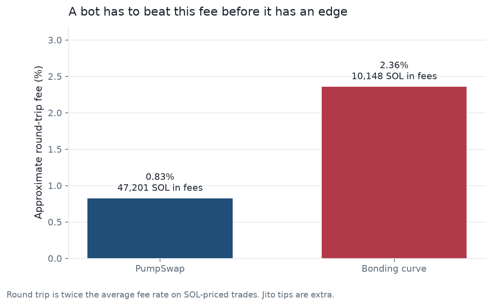
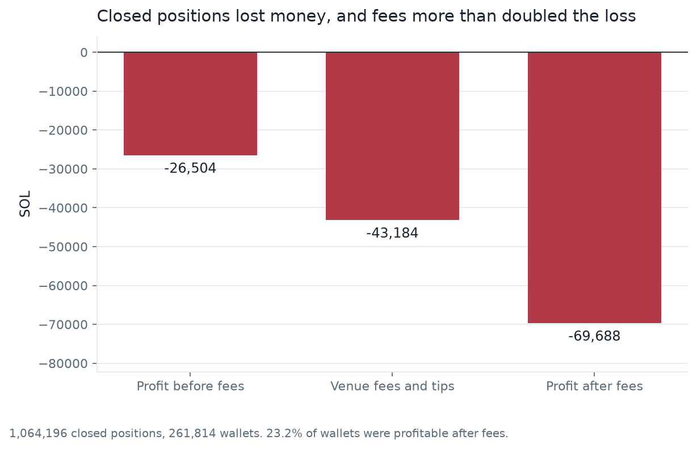
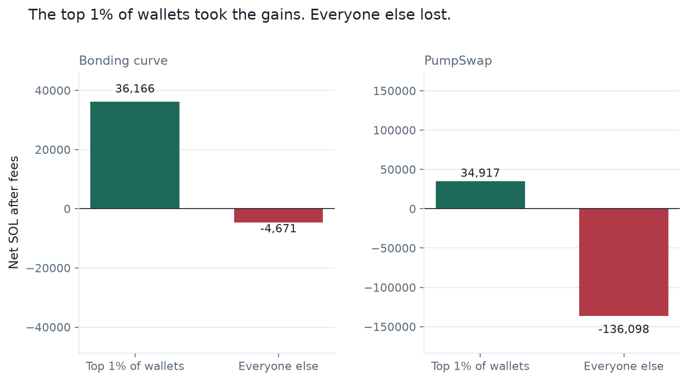
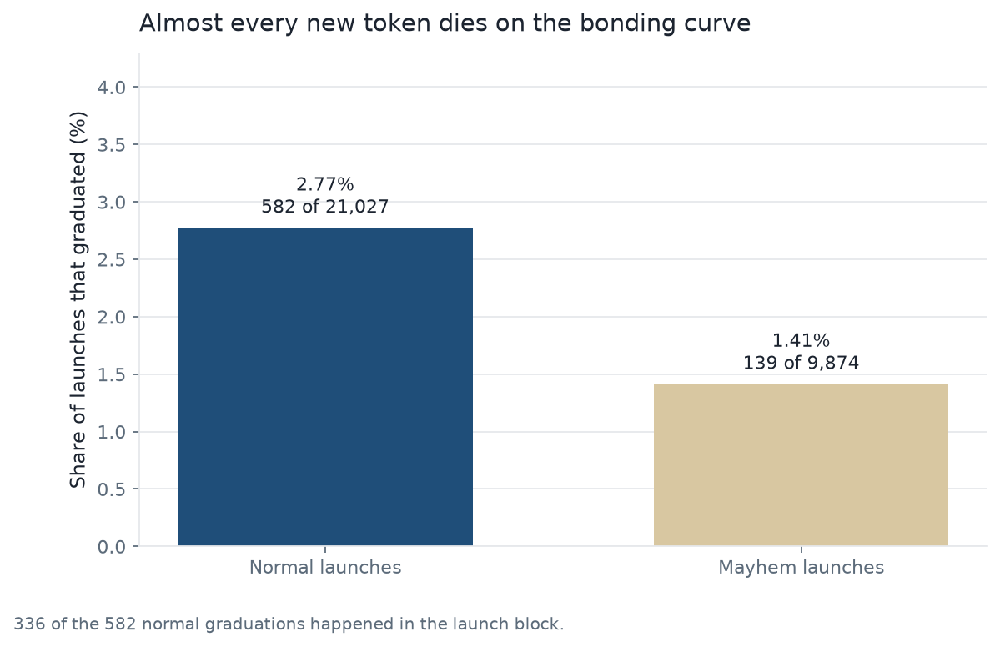
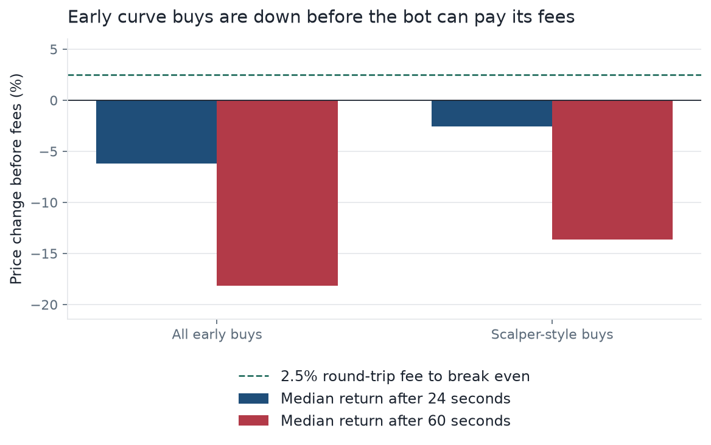
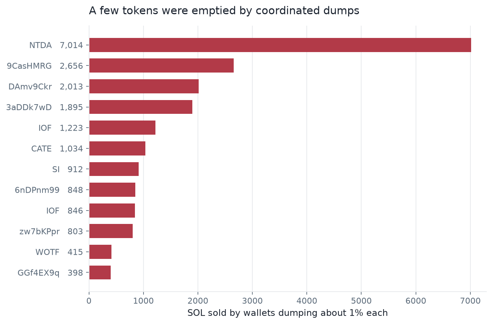

# Where does a trading bot lose money?

One day of Pump.fun and PumpSwap. The trading team had a recorded market and a short list of ideas ready to run: snipe new launches, buy dips, copy profitable wallets, and trade graduations. We used that day to separate a real edge from a fee, and to say which of those ideas the market punishes.

The window is 23.2 hours: Solana slots 451,863,358 to 452,071,879, from 2026-09-30 04:57 UTC to about 2026-10-01 04:10 UTC.

---

## Ask

The team needed a decision before any more size went on: what is allowed to run, what needs a guard, and what has to wait for another day.

We framed the work around four questions.

1. What does a round trip cost, before a strategy has any edge?
2. After a wallet fully exits, who keeps the profit?
3. Do new launches and early curve buys give a follower something it can copy?
4. Are some losses a coordinated dump rather than a slow price move?

A strategy that cannot clear the fee, or that buys into a one-block dump, should not go live. A strategy that only works by being first into the launch cannot be copied.

---

## Prepare

The team decoded the day directly from the chain: every block in the range, none missing. We stored it as ten Parquet tables in `data/`. Those files are too large for GitHub, so the local database is `db/solbot.duckdb`. The queries and the small result tables are what this repo keeps.

One row is one event.

| Table | Rows | One row is |
|---|---:|---|
| `trades` | 15,508,459 | One buy or sell |
| `wallet_positions` | 3,083,140 | One wallet and one token, totaled |
| `early_curve_buys` | 668,412 | A bonding-curve buy 10–400 slots after launch |
| `slots` | 208,261 | One Solana block |
| `sol_transfers` | 37,043 | A SOL transfer seen while tracing funding |
| `wallets` | 35,822 | Who first funded a wallet |
| `launches` | 30,901 | A new token |
| `pools` | 2,636 | A PumpSwap pool |
| `liquidity` | 2,209 | A deposit or withdrawal |
| `graduations` | 777 | A token leaving the bonding curve |

SOL amounts on `trades` are lamports. Divide by 1e9. `wallet_positions` and `early_curve_buys` are already in SOL. A slot is about 0.4 seconds. An empty `quote_mint` means the pool is priced in SOL.

We checked that each table opened and that the row counts match the data dictionary. The chain audit that came with the extract passed on completeness, decoding, and pool math. That is enough to trust the totals for this window. It is not a track record.

What the extract does not include:

- Any day besides this one. Operator behavior can change tomorrow.
- Ordinary priority fees. The net below is a little high because of that.
- Positions still open when the window ended. Those are left out of the closed-position result.
- A clean `quote_amount` on about 20% of older PumpSwap buys, which store the fee inside the amount. The next trade's reserves are correct, and the fee totals are still the right order of magnitude.

The bot's backtest is written up separately in `FINDINGS.md`. This pass measures the market. We did not re-run that backtest.

---

## Process

Fifteen million trades do not fit in a spreadsheet. We loaded the tables into DuckDB, asked the questions in SQL, and drew the charts in Python. The database stays on the machine. GitHub gets the queries, the scripts, and the result CSVs.

`scripts/load_database.py` loads each table and stops if the row count does not match the dictionary. `scripts/run_sql.py` runs every file in `sql/` and writes one CSV to `analysis/results/`. Each Parquet file has a valid header and footer, so the download is complete.

The export was already de-duplicated. We did not edit the source files. We agreed on a few definitions so the totals mean one thing:

- SOL-priced markets only: `quote_mint = ''`.
- A position is closed when the tokens sold are within 2% of the tokens bought, and the wallet both bought and sold inside the window.
- A round trip is twice the average fee rate on that venue.
- A drain is a PumpSwap slot where at least five different wallets each sell about 1% of supply (token amount between 0.9% and 1.1%).
- A scalper-style early buy is the public part of what fast curve bots do: 18–50 slots after launch, the deployer has sold, 3–6 SOL sold in the previous 10 trades, and the price is already down at least 5%.

Those rules are in the SQL, so the result can be rebuilt.

---

## Analyze

### The fee is the hurdle

PumpSwap traded 11.4 million SOL across 12.5 million trades and charged **47,201 SOL** in fees, about **0.83%** for a buy and a sell. The bonding curve traded 0.86 million SOL and charged **10,148 SOL**, about **2.36%** round trip.

Anything that cannot clear that number is a fee payment, not a strategy. Jito tips were small next to venue fees (163 SOL on PumpSwap, 218 SOL on the curve) and sit on top. Query: `sql/01_fee_by_venue.sql`.

### Closed trades lost, and fees more than doubled it

Wallets that fully exited:

| | |
|---|---:|
| Closed positions | 1,064,196 |
| Wallets | 261,814 |
| Profit before fees | −26,504 SOL |
| Venue fees and Jito tips | −43,184 SOL |
| Profit after fees | −69,688 SOL |
| Wallets profitable before fees | 27.8% |
| Wallets profitable after fees | 23.2% |
| Median wallet, after fees | −0.019 SOL |

The crowd was down before fees. Fees were the larger line. Query: `sql/03_closed_round_trips.sql`.

### The profit sits with a few wallets

| Venue | Wallets | Top 1% after fees | Everyone else |
|---|---:|---:|---:|
| Bonding curve | 112,174 | +36,166 SOL | −4,671 SOL |
| PumpSwap | 181,170 | +34,917 SOL | −136,099 SOL |

On the curve, the top 1% made more than the venue's net, because everyone else lost. On PumpSwap everyone else lost 136,099 SOL. Copying a list of recently profitable wallets still arrives late and pays the fee again. The wallets at the top of this table are often in the launch block. A follower cannot be first. Query: `sql/05_profit_is_concentrated.sql`.

### New tokens usually die on the curve

| Launch type | Launches | Deployers | Graduated | Rate | Graduated in the launch block |
|---|---:|---:|---:|---:|---:|
| Normal | 21,027 | 9,610 | 582 | 2.77% | 336 |
| Mayhem | 9,874 | 738 | 139 | 1.41% | 0 |

Sniping new launches mostly means buying a token that never gets a PumpSwap pool. Of the normal tokens that did graduate, 336 of 582 graduated in the same block they launched, because the creator bought the curve out immediately. That is a different market from an ordinary new token.

Of those 336 instant graduations, 138 had at least 150 SOL of buying in the first moments, and 46 had at least 300. The median early buy was 148 SOL. Buying every graduation and buying the rare ones with heavy early flow are not the same trade. Queries: `sql/06_launch_outcomes.sql`, `sql/07_hot_money_is_rare.sql`.

### An early curve buy is down before the fee is paid

Price change before fees, for 668,412 early bonding-curve buys:

| Setup | Buys | Median after 24 seconds | Median after 60 seconds | Share up enough to clear a 2.5% fee |
|---|---:|---:|---:|---:|
| All early buys | 668,412 | −6.18% | −18.16% | 35.1% |
| Scalper-style buys | 6,500 | −2.54% | −13.65% | 40.1% |

Break-even on the curve is about **+2.5%**. The typical buy is below zero. The scalper-style slice has a positive average after 24 seconds (+3.1%) because of a few large winners. The median is still negative. A bot that takes the typical trade does not clear the fee. Query: `sql/08_early_curve_forward_returns.sql`.

### Some losses are a dump, not a dip

On 53 tokens, at least five wallets each sold about 1% of supply in the same slot. Across 80 such slots they sold **21,377 SOL**. The busiest slot had 100 wallets. The largest, NTDA, was **7,015 SOL** about 16 minutes after graduation.

A dip-buying rule sees the first of those sells as a discount and is still in the position while the rest of the wallets sell. A stop does not outrun a one-slot collapse. Queries: `sql/09_drain_summary.sql`, `sql/10_largest_drains.sql`.

---

## Share

We walked the team through six charts. The title of each one is the finding. The files are in `analysis/figures/`.

**A bot has to beat the fee before it has an edge.** PumpSwap is about 0.83% round trip. The bonding curve is about 2.36%.

**Closed positions lost money, and fees more than doubled the loss.** −26,504 SOL before fees, −69,688 SOL after. 23.2% of wallets were profitable after fees.

**The top 1% took the gains. Everyone else lost.**

**Almost every new token dies on the bonding curve.** 2.77% of normal launches graduated. 1.41% of mayhem launches did.

**Early curve buys are down before the bot can pay its fees.** The dashed line is the 2.5% the curve charges for a round trip. Both medians are below zero.

**A few tokens were emptied by coordinated dumps.** NTDA alone was 7,015 SOL.

The market paid a small set of wallets who were already in the launch, and charged everyone else a fee on the way to a loss. A bot that arrives later, buys the dip, or copies a typical winner is on the wrong side of that split.

---

## Act

On this day the losing patterns are structural. Fees are larger than the typical move. New launches rarely graduate. Early curve buys are down within a minute. The profit sits with wallets a follower cannot imitate. Some of the largest losses are coordinated dumps.

We recommended three things.

1. **Leave sniping, dip-buying, and copy-trading off.** Sniping buys a set of tokens of which about 97% never graduate. Dip-buying walks into the dumps above. Copy-trading pays a second fee to arrive after the wallet that was first. The closed-position table is the check: after fees, 23.2% of wallets made money and the group lost 69,688 SOL.

2. **Treat the fee as a gate.** A candidate has to clear about **2.4%** round trip on the bonding curve and about **0.8%** on PumpSwap before it is worth tuning. Measure that cost at entry, not after the trade has moved into another fee tier.

3. **Put a drain guard on entries, and get another day before sizing any narrow winner.** Count distinct sellers of about 1% of supply in one slot, and skip that token. The large dumps here often started at least 16 minutes after graduation, which is why a short hold can miss some of them and a long hold cannot. The team's backtest in `FINDINGS.md` found one setup that made money on this same day: instant graduations with heavy early buying, exited inside 10 minutes. That threshold was chosen after seeing the full day. We did not re-test it. It needs a day it has not seen.

We did not treat sandwiching other traders, or launching tokens in order to dump them, as options. Both show up in the wallet record. Neither is something we would ship.

The same SQL on a second day would tell us whether this was the market or just this Tuesday. Priority fees and deployer history across days are the other gaps. Until then, the claim is about this window.
